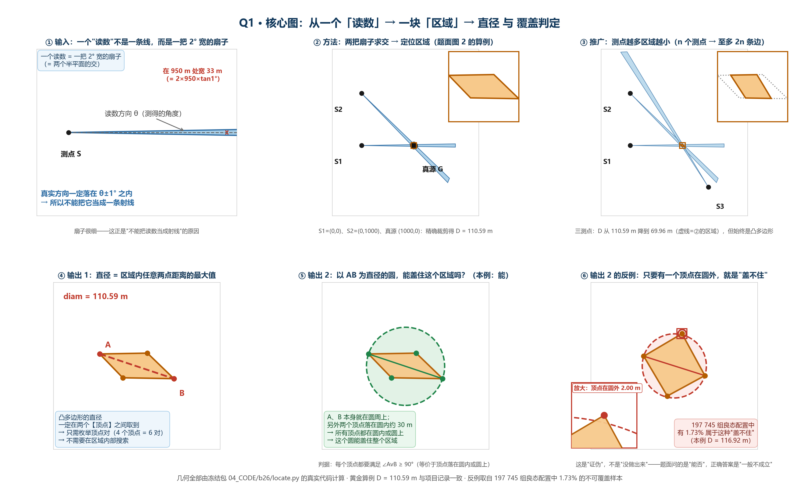
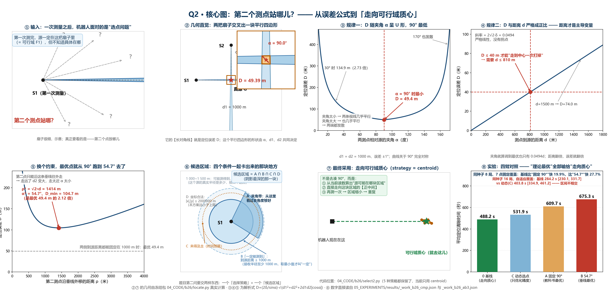
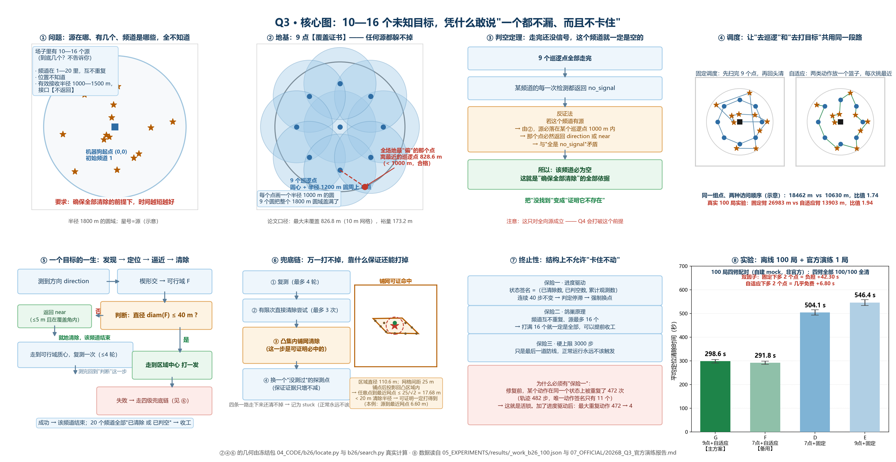
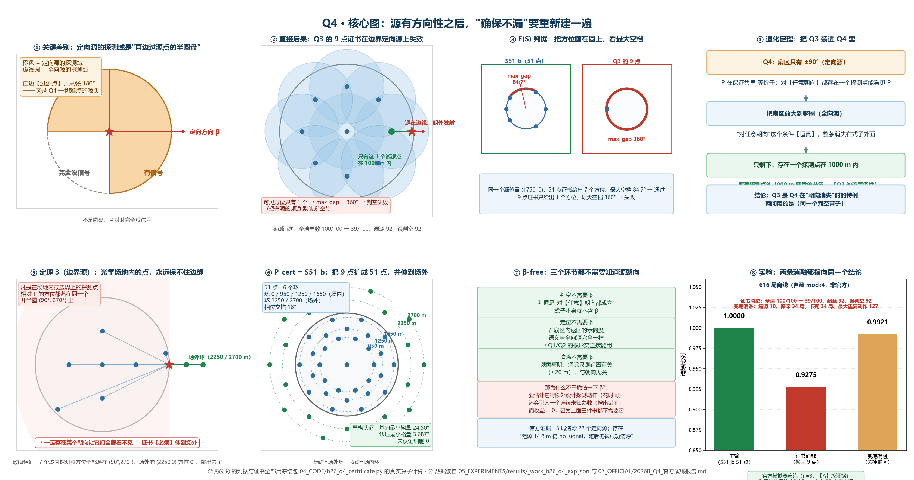

# 2026 全国大学生数学建模竞赛 B 题

机器人自主搜索与目标清除问题的建模、求解与论文写作全过程记录。

## 目录

| 路径 | 内容 |
| :--- | :--- |
| [`00_赛题与原始资料/`](./00_赛题与原始资料/) | 题目原文、附件、格式规范、论文模板 |
| [`01_模型与代码/`](./01_模型与代码/) | 核心代码包 `b26` + 模型文档 + 代码文档 |
| [`02_数据与正式测试/`](./02_数据与正式测试/) | 测试数据与正式测试记录 |
| [`03_图表与绘图/`](./03_图表与绘图/) | 论文图表与绘图脚本 |
| [`04_证据与审计/`](./04_证据与审计/) | 结果证据链与一致性审计 |
| [`05_论文写作/`](./05_论文写作/) | 论文正文与素材 |
| [`06_参考资料/`](./06_参考资料/) | 数学建模方法与算法知识库 |
| [`07_项目知识库/`](./07_项目知识库/) | 项目内的经验沉淀 |

## 核心代码包 `b26`

模块按**单一职责**拆分，互不耦合：

```
robot.py      主控：搜索 → 发现 → 定位 → 移动 → 清除
              （含活锁修复与进度驱动终止）
   │
   ├── locate.py    定位：楔形/半平面交/交集/直径/可行域账本（只做几何）
   ├── detect.py    检测：三态语义解析（只做解析）
   ├── motion.py    移动：虚拟时间账（只记时间）
   ├── search.py    搜索：覆盖点集 + 覆盖证书
   ├── path.py      路径：最近必做调度（只做排序）
   └── select2.py   选点：5 种策略（依赖 locate）
                │
                ▼
            comm.py   通信：HTTP+JSON / 串行 / 幂等 / 重试 / 日志
```

设计上 `locate.py`、`detect.py`、`motion.py` 等**完全不知道模拟器存在**，
只负责各自的数学或逻辑职责，便于单独测试与替换。

架构说明见 [`01_模型与代码/代码文档/ARCHITECTURE.md`](./01_模型与代码/代码文档/ARCHITECTURE.md)。

## 四问求解结果







*Q1~Q4 核心结果图。原始图稿在 [`03_图表与绘图/`](./03_图表与绘图/)。*

## 模型文档

| 文档 | 内容 |
| :--- | :--- |
| `2026B_赛题分析报告.md` | 题目拆解与关键约束识别 |
| `2026B_模型选型报告.md` | 候选模型对比与选型依据 |
| `2026B_模型建立与求解报告.md` | 完整建模过程与求解结果 |
| `2026B_Q1-Q4_统一技术路线.md` | 四问的统一框架 |
| `2026B_创新设计报告.md` | 创新点说明 |
| `2026B_问题1-2_定位模型与检测点优化.md` | 定位模型的细节推导 |

## 参考资料

[`06_参考资料/数学建模竞赛知识库/`](./06_参考资料/数学建模竞赛知识库/) 是自建的方法库：

- 真题编目（1992–2010 / 2011–2024）
- 数学模型库（机理、概率、评价、优化…）
- 算法库（二分法、牛顿法、梯度下降…）
- 优秀论文逆向分析
- 模型选择决策树

## 许可

本仓库为竞赛参赛作品记录。题目与附件版权归竞赛主办方所有。
